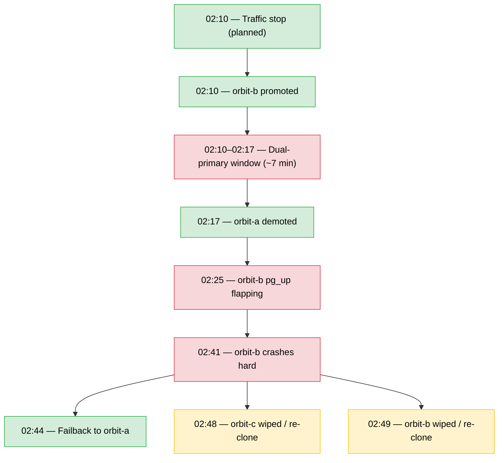
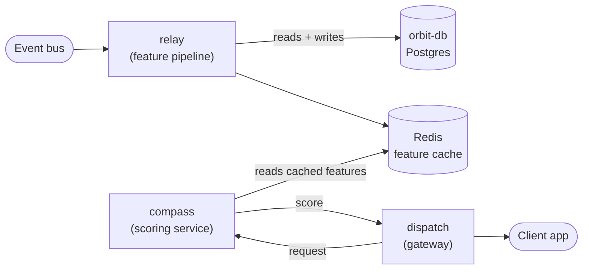

> **This is a synthetic demo, not a real incident.** It was generated end-to-end by an AI incident-response agent (built on the Claude API) against a simulated dataset of metrics, logs, and a fictional demo codebase — built to show the agent's output format and reasoning depth. No real company, system, or event is represented.

# Incident Report: `orbit-db` Failover and the Fallback Cascade in `compass`

| | |
|---|---|
| **Incident ID** | DEMO-2026-06-14 |
| **Environment** | Simulated (synthetic telemetry + demo codebase) |
| **Time (UTC)** | 02:10:00 – 04:11:00 |
| **Duration** | ~2h 1min (primary outage ~40 min; replica rebuild ~53 min) |
| **Severity** | P2 (simulated) |
| **Status** | Resolved |
| **Services** | `orbit-db` (PostgreSQL), `relay` (feature pipeline), `compass` (scoring service), `dispatch` (gateway) |
| **Generated by** | AI incident-response agent (v1 demo) |

---

## Summary

A planned switchover moved the `orbit-db` primary role from `orbit-a` to `orbit-b`. The traffic-stop step executed cleanly, but demotion of the old primary was not atomic with promotion of the new one, leaving a ~7-minute dual-primary window. `orbit-b` then crashed 17 minutes after taking over as sole primary, for a cause not identifiable from available metrics — forcing failback to `orbit-a` and full rebuilds of `orbit-b` and the cross-region replica `orbit-c`.

Downstream, `relay` — an async worker that keeps a Redis feature cache warm for the real-time scoring service `compass` — suffered rapid memory growth and repeated pod evictions in step with each database flap, driven by an undersized connection pool (`MaxConnIdleTime = 2s`, `MaxConns = 10`) fighting up to 600 concurrent goroutines. `compass` itself doesn't talk to Postgres directly; it reads pre-computed features from Redis. That decoupling delayed its failure by roughly 40 minutes, but once enough cached features aged past their TTL without refresh, `compass` shifted a large share of live predictions to hardcoded fallback values for about 50 minutes. Neither service's circuit breaker ever tripped, and `relay`'s health check was hardcoded to return `200 OK` regardless of database state, so Kubernetes had no signal to act on early.

---

## Detection Method

- `pg_up` and `pg_replication_is_replica` flapping on `orbit-b`, first observed via Prometheus at 02:25:00.
- `relay` pod evictions detected via `container_memory_working_set_bytes` and `kube_pod_container_status_restarts_total`.
- `compass` fallback-rate spike detected via `compass_total_fallback_scores`, climbing from a baseline of ~30/5min to over 18,000 within five minutes.
- Root cause of the downstream cascade confirmed by source review of the demo `relay` and `compass` services (connection pool config, worker concurrency, health check implementation, circuit breaker wiring).

---

## Timeline

| Time (UTC) | Host / Service | Event |
|---|---|---|
| 02:10:00 | `orbit-a`, `orbit-b` | Traffic-stop step of planned switchover executes; throughput drops to near zero. |
| 02:10:30 | `orbit-b` | Promoted to primary. |
| 02:10:30 – 02:17:45 | `orbit-a` + `orbit-b` | **Dual-primary window (~7 min):** both nodes report as primary simultaneously. |
| 02:17:45 | `orbit-a` | Demoted to replica; switchover formally completes. |
| 02:25:00 | `orbit-b` | `pg_up` begins flapping. |
| 02:41:10 | `orbit-b` | Goes fully down (`pg_up = 0`, sustained). |
| 02:44:30 | `orbit-a` | Promoted back to primary — failback. |
| 02:48:15 | `orbit-c` (cross-region) | Unreachable; PGDATA wiped, full re-clone begins. |
| 02:49:00 | `orbit-b` | PGDATA wiped; rebuilt as replica of `orbit-a`. |
| 03:21:00 | `compass` | **Fallback-score storm begins** — ~40 min after the `orbit-b` crash. |
| 03:41:00 | `orbit-b` | Back online as replica. |
| 03:45:30 | `orbit-c` | Back online, fully rebuilt. |
| 04:11:00 | `compass` | Fallback storm resolves, ~26 min after database recovery completes. |

### `relay` pod evictions (during 02:25–02:41 flapping)

| Time (UTC) | Pod | Memory pattern | Outcome |
|---|---|---|---|
| 02:25:00 – 02:27:20 | `relay-7f9c-kg4d` | 98MB → 360MB in 2m20s | Evicted under memory pressure |
| 02:33:40 – 02:36:10 | `relay-7f9c-klsv` | 40MB → 340MB in 2m30s | Evicted, trending toward 512Mi limit |

Both replacements showed `restarts_total = 0` for the pod's lifetime — Kubernetes replaced the pod outright rather than restarting a container in place, consistent with OOM-pressure eviction, not an application crash.

---

## Investigation Narrative

### Database failure

The dual-primary window points to non-atomic demotion — a clean switchover tool fences or stops the old primary at or before promoting the new one; here, both nodes reported as primary for seven minutes. `orbit-b`'s crash 17 minutes after takeover was checked against the usual suspects and none matched:

| Hypothesis | Evidence against |
|---|---|
| Host reboot | System uptime never reset |
| OOM kill | `mem_oom_kill_total` stayed at 0 throughout |
| Disk-full | Multiple TB free on `orbit-b` before and during the incident |
| Connection exhaustion | Backend count stayed well under `max_connections` |
| Storage stall | I/O pressure never spiked despite I/O throughput dropping to zero |

Because `orbit-b` stopped uncleanly rather than at a known-safe WAL position, both rebuilds required a full `pg_basebackup` (~50 min each) instead of a fast `pg_rewind`.

### Downstream cascade — `relay` and `compass`

`compass` never talks to Postgres directly — it only reads features that `relay` has already cached in Redis. That indirection is why the outage didn't hit `compass` immediately, and why it arrived roughly 40 minutes late instead.

**Why `relay` blew up:** its connection pool was configured with `MaxConnIdleTime = 2s` against only `MaxConns = 10`, forcing near-continuous connection teardown and re-establishment. Incoming events fan out across up to 600 concurrent goroutines, all contending for that same 10-connection pool. Against a flapping database, large numbers of goroutines piled up blocked on connection attempts and query timeouts instead of failing fast — the direct driver of the memory spikes. Its health check was hardcoded to `200 OK` regardless of database state, so Kubernetes had no way to detect the underlying problem through that signal.

**Why `compass` failed late, and only partially:** once `relay` stopped refreshing the cache, entries aged past their TTL without renewal. After roughly 40 minutes, enough cached features were stale or missing to push `compass` into fallback-score generation. The storm resolved about 26 minutes after `orbit-c` finished rebuilding — consistent with `relay` needing time to catch up on stale refreshes once the database was healthy again. Both services had circuit breakers defined in their metrics, but neither one ever tripped during the incident — the breaker logic was wired to the wrong failure signal and never engaged.

---

## Root Cause Analysis

### Proven

1. **Database:** `orbit-b` crashed 17 minutes after becoming sole primary, forcing failback and full rebuilds of two nodes. Specific trigger unidentified from available metrics; server and switchover-tool logs would be required.
2. **`relay`:** Memory blowup and pod evictions were caused by a connection-pool/concurrency mismatch, not an unhandled error — every reviewed query path had proper error handling. The health check gave Kubernetes no visibility into the actual failure.
3. **`compass`:** The ~50-minute fallback-score storm was caused by Redis feature-cache staleness once `relay` could no longer refresh it, compounded by circuit breakers that never engaged.

### Open questions (would need production log access to close)

- Why `orbit-a`'s demotion wasn't atomic with `orbit-b`'s promotion.
- The specific trigger for `orbit-b`'s crash.
- Whether a post-promotion health gate was expected by the switchover runbook.

---

## Impact (simulated)

- ~40 minutes of write downtime on the primary.
- ~50-minute window where `compass` served a large share of predictions from fallback values instead of live scores.
- No hard downstream outage — request throughput at `dispatch` showed no traffic-driven cliff, consistent with a prediction-quality degradation rather than a full pipeline stop.

---

## Recommended Actions

| # | Action | Priority | Notes |
|---|---|---|---|
| 1 | Alert on `relay` memory approaching limit (`working_set / limit > 0.8`) | P1 | Would have caught both evictions minutes before they happened. |
| 2 | Alert on `compass` fallback-score rate exceeding baseline | P1 | Would have surfaced the storm within ~5 minutes instead of after the fact. |
| 3 | Make demotion atomic with promotion in the switchover procedure | P1 | Eliminates the dual-primary window entirely. |
| 4 | Make `relay`'s health check reflect real dependency health | P1 | Currently hardcoded `200 OK`; split into liveness + a readiness check that pings Postgres/Redis with a bounded timeout. |
| 5 | Fix the pool/concurrency mismatch in `relay` | P1 | Raise `MaxConnIdleTime`, bound worker concurrency against pool size, add a real circuit breaker ahead of DB calls. |
| 6 | Add a post-promotion canary window to the switchover runbook | P2 | Synthetic checks for a few minutes after cutover would have caught `orbit-b` flapping before failback became necessary. |
| 7 | Wire up (or remove) the dead circuit-breaker metrics on both services | P2 | Defined but never incremented — currently gives false confidence. |
| 8 | Prefer stale-but-real cached data over hardcoded fallback in `compass` | P2 | Best-supported fix for the ~40-minute delayed cascade. |

---

## How this was generated

This report was produced by a demo AI incident-response agent: a script feeds simulated Prometheus alert data and application log lines for a synthetic outage into the Claude API, which correlates the signals, reconstructs the timeline, classifies severity, and drafts the RCA narrative and action list above. In its current (v1) scope the agent stops at a suggested fix — a human still reviews and executes any remediation. The real value it's aimed at: compressing the hour(s) of manual metric-correlation and log-reading that a report like this normally takes into a first draft an on-call engineer can verify and ship in minutes.
